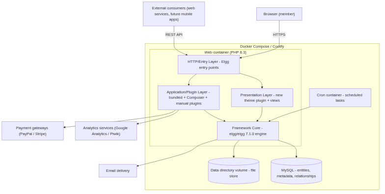

# Architecture

Spiritual Family Network — core architecture for initial project scaffolding.

## Architecture Overview

Spiritual Family Network is a containerized modular monolith built on Elgg
7.1.0 and PHP 8.3. Docker Compose orchestrates the web, db, and cron services,
and the stack deploys to Coolify (REQ-DEPL-2, REQ-DEPL-3). All features are
delivered through Elgg's plugin architecture: bundled Elgg 7.1.0 plugins,
Composer-installed vendor plugins, and manually installed plugins (see
`docs/tech_stack.md`).

## Core Layers

1. HTTP/Entry Layer: web server plus PHP 8.3 serving Elgg's public entry
   points (index, pages, actions, views); runs as the web Docker container
   (REQ-DEPL-1).
2. Presentation Layer: Elgg views system with a new theme plugin replacing the
   Aalborg / L1 / paul_override / custom_index stack (REQ-FR-TR-1); the
   bundled custom_index plugin is deactivated or overridden by the new theme.
3. Application/Plugin Layer: all feature delivery via Elgg plugins — bundled
   Elgg 7.1.0 plugins, Composer-installed ColdTrick/vendor plugins, and
   manually installed plugins.
4. Framework Core: the elgg/elgg 7.1.0 engine — entity/metadata/relationship
   model, events and hooks system, actions, views, and access control.
5. Data Layer: MySQL database for entities, metadata, and relationships; the
   Elgg file store (data directory volume) for uploads such as photos, videos,
   and files.

## Cross-cutting Concerns

- Error Handling: Elgg exception hierarchy with registered error and exception
  handlers; PHP 8.3 strictness is a standing upgrade constraint.
- Logging: Elgg built-in logging plus the bundled system_log and developers
  plugins (REQ-FR-DAT-1); log rotation via container/cron replaces the dropped
  logbrowser and logrotate core plugins (REQ-FR-PU-7).
- Security: HTMLawed input filtering (REQ-FR-PS-9), the Elgg access system and
  action tokens (CSRF), user validation by email (REQ-FR-PS-3), captcha
  (REQ-FR-PS-4), and the authenticated web services API (REQ-FR-PS-7).
- State Synchronization: PHP sessions plus the Elgg cache layer (simplecache,
  systemcache) shared across requests; a single web container avoids cache
  drift.
- Configuration: Elgg `settings.php` plus environment variables injected by
  Docker Compose/Coolify; `composer.lock` pins exact dependency versions.

## Integration Patterns

- External Service Integration: analytics via `coldtrick/analytics`; payment
  gateways (PayPal, Stripe) via manually installed payment plugins; email
  delivery via the Elgg email service.
- Inter-service Communication: the bundled web_services plugin plus
  `elgg/data_views` expose REST endpoints for external consumers such as
  future mobile apps (REQ-FR-PS-7, REQ-FR-PS-8); no internal message bus —
  in-process hooks only.
- Event Handling: the Elgg event/hook system; plugins register hook handlers
  (for example `email`, `system`) and cron hooks for scheduled jobs.
- State Persistence: MySQL for entities and metadata; the data-directory
  volume for files; rebuildable Elgg caches; a dedicated cron container runs
  scheduled tasks (garbagecollector, uservalidationbyemail, event digests).

## Component Interactions

Request flow: browser → HTTPS → HTTP/Entry Layer → Presentation Layer and
Application/Plugin Layer → Framework Core → Data Layer.

Dependency rules: every layer points inward to the Framework Core; plugins
never bypass core hooks and events; the cron container invokes the core the
same way web requests do.

## Interface Contracts

- Plugin bootstrap contract: each plugin's `start.php` registers its views,
  actions, hooks, events, and cron handlers with the core.
- Event/hook handler signatures: handlers receive the hook name, type, return
  value, and params, and return the possibly modified value.
- View override/extension rules: themes override or extend views through the
  Elgg views system; plugins must not patch core view files directly.
- Web services API surface: REST endpoints declared by web_services and
  exposed with data_views (REQ-FR-PS-7, REQ-FR-PS-8).
- Entity/metadata model conventions: content entities extend `ElggObject`
  with a plugin-declared subtype and use the core access system.
